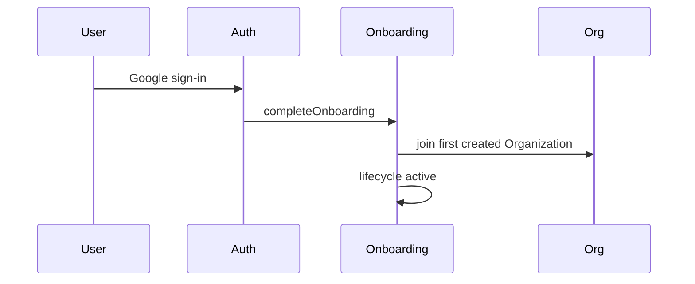

# Architecture

Implementation map for the B2B template. Domain vocabulary: [AGENTS.md](../AGENTS.md). Decisions: [ADR 0001](./adr/0001-b2b-tenancy-and-platform-admin.md).

## Stack

- **Frontend**: Vite, React, TypeScript, TanStack Router, Tailwind, shadcn/ui — see [frontend.md](./frontend.md)
- **Backend**: Convex (queries, mutations, real-time sync)
- **Auth**: Convex Auth + Google OAuth
- **Tenancy**: `@djpanda/convex-tenants` (Organizations, Memberships, Invitations)
- **Authorization**: `@djpanda/convex-authz` (org-scoped permissions, platform admin role)
- **Email**: Resend (emulated in dev on port 4003)

## Frontend routes

Defined in `client/src/routes/` (TanStack Router; generated tree in `client/src/routeTree.gen.ts`):

| Route                    | Access         | Purpose                                             |
| ------------------------ | -------------- | --------------------------------------------------- |
| `/`, `/login`            | Public / auth  | Dashboard or sign-in                                |
| `/admin`                 | Platform Admin | Cross-org provisioning, org switcher, impersonation |
| `/settings/members`      | Org Admin      | Member management                                   |
| `/settings/teams`        | Org Admin      | Team UI (grouping only in v1)                       |
| `/settings/org`          | Org Admin      | Organization settings                               |
| `/accept-invitation/:id` | Public         | Invitation accept → Google sign-in                  |
| `/dev/permissions`       | Dev only       | Permission matrix demo                              |
| `/dev/tenants`           | Dev only       | Tenants component demo                              |
| `/dev/form`              | Dev only       | TanStack Form + Zod validation demo                 |
| `/dev/inbox`             | Dev only       | Resend emulate inbox viewer                         |

Dev routes require `import.meta.env.DEV` or `VITE_E2E=true` (`client/src/lib/dev-tools.ts`).

## Convex modules

```text
convex/
├── auth.ts              # Convex Auth + OAuth gate before sign-in
├── authz.ts             # Permission definitions and checks
├── tenants.ts           # Organization/Membership/Invitation API surface
├── onboarding.ts        # Provision, invite, activate, deprovision users
├── platform.ts          # Platform admin: orgs, impersonation
├── todos.ts             # Reference org-scoped resource + ABAC pattern
├── emails.ts            # Resend send (prod + emulate)
├── users.ts             # User profile helpers
├── schema.ts            # users.onboardingStatus, todos, impersonationSessions
├── testing/e2e.ts       # E2E seed reset (dev only)
└── lib/
    ├── auth.ts          # Platform admin allowlist + role checks
    ├── onboarding.ts  # Lifecycle: pending / invited / active
    ├── invitations.ts # Invitation email content + send
    ├── tenantsClient.ts
    ├── users.ts         # Email normalization, canonical user resolution
    ├── orgAccess.ts     # Org permission helpers
    ├── succession.ts    # Reassign org resources on member departure
    └── googleProvider.ts
```

## Auth and onboarding flow



- `convex/auth.ts` — `createOrUpdateUser` activates onboarding during sign-in
- `convex/lib/onboarding.ts` — auto-joins the first created Organization (creates Instituto Blooma if none exist). Optional Invitations are still accepted when present.

See [onboarding.md](./onboarding.md) for product-facing flows. ADR: [0004](./adr/0004-auto-join-first-organization.md).

## Authorization model

- Org-scoped checks: `authz.withTenant(organizationId)` + permission strings (e.g. `todos:read`, `members:add`)
- Platform admins: global `platform_admin` role; bypass org membership via `convex/lib/auth.ts`
- Reference implementation: `convex/todos.ts` — org permissions plus ABAC (users may update their own todos)

**Rule for new tables**: include `organizationId`, enforce checks server-side in every query/mutation. See ADR 0001.

## Platform admin

- Bootstrap: `PLATFORM_ADMIN_EMAILS` env → allowlist; runtime `platform_admin` authz role
- UI: `client/src/pages/platform-admin.tsx` at `/admin`
- Impersonation: token swap, audited in `impersonationSessions`, banner in `impersonation-banner.tsx`

## Dev emulators

| Service      | Port (local) | Config                                          |
| ------------ | ------------ | ----------------------------------------------- |
| Google OAuth | 4002         | `emulate.config.yaml`, `script/dev-emulate.mjs` |
| Resend       | 4003         | `script/dev-emulate-resend.mjs`                 |

`pnpm run dev:all` starts both emulators, Convex, and Vite. Seeded Google personas: `emulate.config.yaml`.

## Related

- [frontend.md](./frontend.md)
- [environment.md](./environment.md)
- [testing.md](./testing.md)
- [customization.md](./customization.md)
